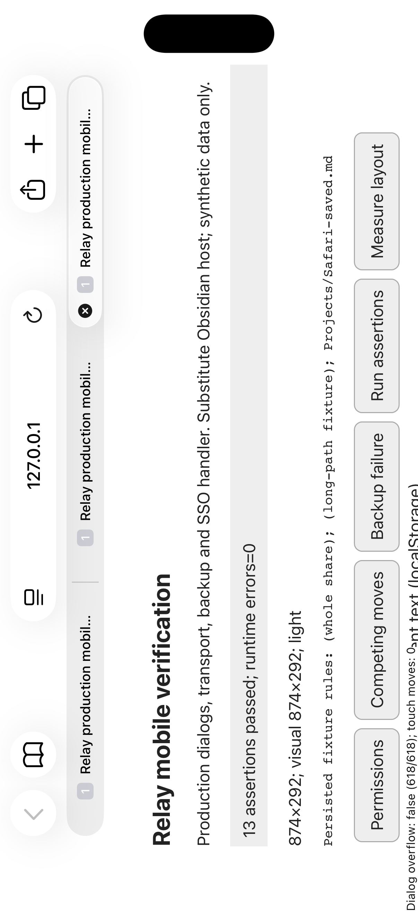
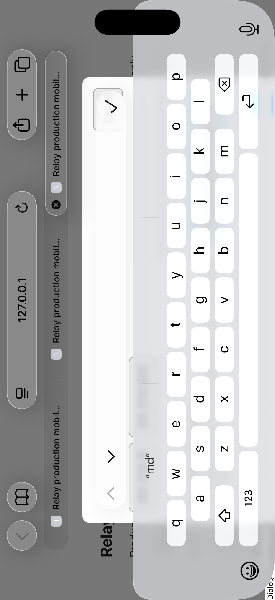
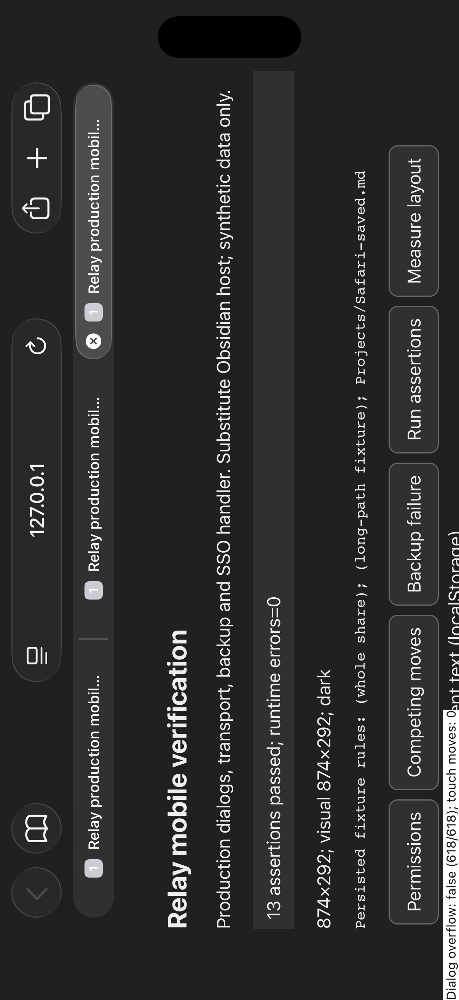

# Simulator Safari — landscape

Device/runtime: iPhone 17 Pro, iOS 26.5 (23F77), Xcode 26.6 (17F113).
Safari viewport **874×292 CSS px**, with browser tabs/chrome visible. Rotation
used Simulator's controls. Both light and dark inspected; production components
and CSS ran in real WebKit with the minimal host adapter.

Passed:

- 13 production-code assertions with zero captured runtime errors in landscape.
- Permission draft `Projects/Safari-saved.md` survived rotation with the
  software keyboard open. Dismissal exposed the unchanged field.
- Actual taps on Add rule and Save permissions succeeded. Reloading the page
  retained the rule; the final results display it from localStorage.
- Long-path dialogs measured 618/618px (`scrollWidth/clientWidth`). Buttons
  remained reachable through the harness navigation aids and had 44px targets.
- Actual tap on the recovery decision in the backup-failure fixture retained
  the conflict. Returning to portrait exposed the inline error for inspection.
- Dark/light styles and orientation changes preserved the fixture document.

Limitation: the software keyboard obscures most of the **substitute** modal in
this short viewport. The native Done/checkmark button stays reachable, and
dismissing it restores form access. Native Obsidian keyboard avoidance needs
device testing. The tool generated no touch-move events; landscape scrolling
and horizontal panning were not verified as natural gestures. The labelled
scroll aids are test navigation, not gesture evidence.

The PNGs below are unmodified `simctl io screenshot` output. This runtime saves
the native 1206×2622 framebuffer even in landscape, so their content is sideways;
rotate the viewer clockwise to read them. The UI viewport was 874×292.

Zero page errors, unhandled rejections or console errors were captured. Native
date/time controls do not apply; there is no permission/recovery Undo action.
Neither this WebKit check nor desktop emulation proves native Obsidian behavior.
