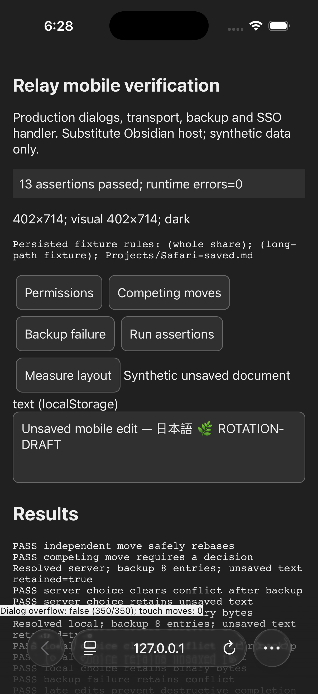
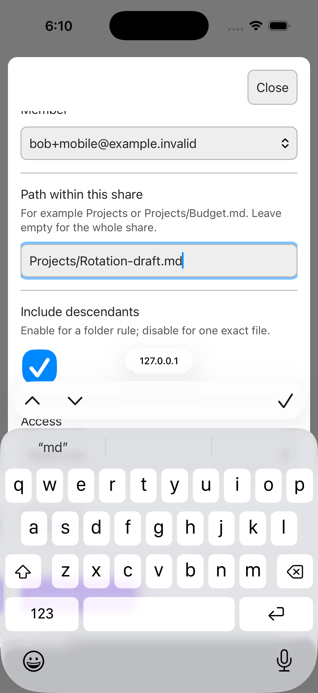
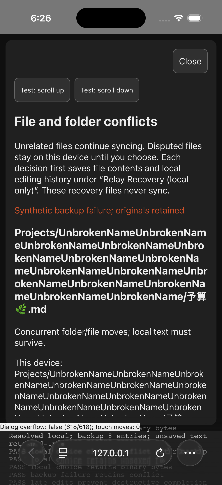
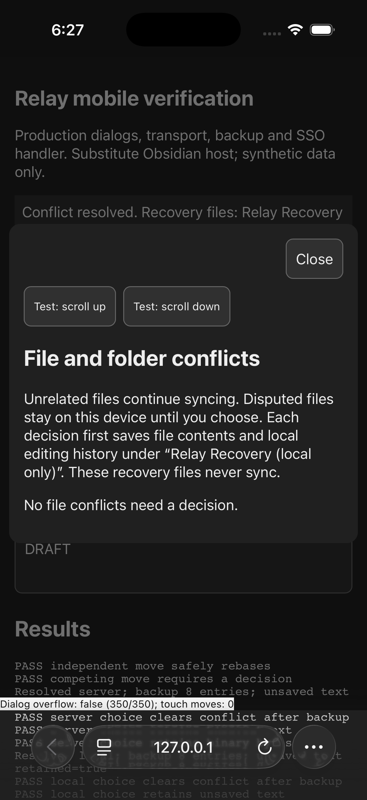

# Simulator Safari — portrait

Device/runtime: iPhone 17 Pro, iOS 26.5 (23F77), Xcode 26.6 (17F113).
Safari viewport **402×714 CSS px**; earlier software-keyboard visual viewport
**402×377**. Harness at `http://127.0.0.1:4177`, real WebKit and production
component imports, substitute Obsidian host. Both light and dark inspected.

Passed:

- 13 final assertions, zero captured runtime errors.
- Production permission form: long unbroken Unicode path wraps; dialog
  `scrollWidth/clientWidth` 350/350; 44px action targets.
- Actual tap focus, typing, native select popup, checkbox and software keyboard
  controls. Draft survived landscape rotation and return to portrait.
- Removing another rule retained an unfinished path. This was also covered by
  the production-component assertion and dedicated tests for every form field.
- User-confirmed touch scroll produced 65 touch-move events without changing
  fields. Automated drags could not reproduce this; navigation aids used later.
- Saved permission path `Projects/Safari-saved.md` and textarea marker
  `ROTATION-DRAFT` survived a page reload. The actual permission dialog reopened
  against persisted fixture rules during assertions.
- Actual tap on **Keep my local layout** resolved the conflict and showed the
  empty queue; backup and unsaved-text assertions passed.
- Failed backup displayed an error while retaining the conflict. Light/dark
  text, Unicode and long paths remained readable. These dialogs use text
  actions; native Obsidian icon/focus behavior is outside the adapter.

Initial long-path clipping was fixed in production CSS. No uncaught errors
were observed after rebuilding/reloading. Date/time controls and decision Undo
do not apply. Natural horizontal panning was not verified by the tool.

The initial light assertion screenshot and before-fix clipping screenshot are
also retained in this directory. This is Safari with a substitute host, not
native Obsidian on an iPhone.
