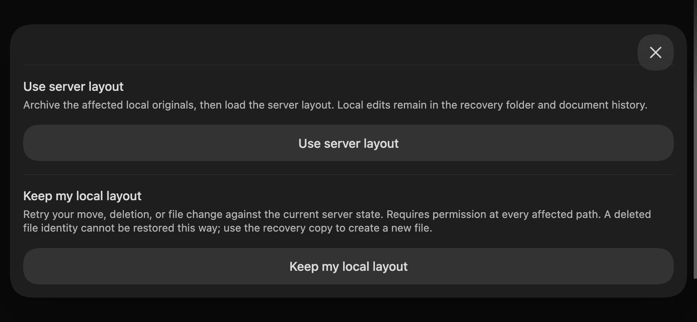

# Desktop Obsidian — landscape

Environment: Obsidian 1.13.7, preview 0.2.2, same disposable vault and real
loopback stack as the portrait record. DevTools rotated to **844×390** while
Obsidian mobile emulation remained enabled. Dark host appearance.

Passed through actual Obsidian UI:

- Rotated the open permission form; `Mobile/Portrait.md` draft remained.
  Add rule and Save permissions worked. Portrait reopening after app reload
  showed the rule with Read only / descendants enabled.
- Rotated the reopened persisted conflict dialog; scrolled to both readable
  44px-high decision buttons and selected **Use server layout**.
- The dialog reported no remaining decisions and displayed the recovery path.
  Disk inspection found `OFFLINE MOBILE EDIT TO RECOVER` in `files/`,
  `originals/`, readable `documents/` history and `Team/Remote-mobile.md`.
  Inventory/document Yjs exports and `BACKUP-COMPLETE.txt` were also present.
  A fresh independent relay peer received the exact preserved text afterward.
- No new runtime errors. The earlier client-ID warning stopped after the fix.

Both dimensions use the actual Obsidian host in desktop Chromium. At the end,
`this.app.emulateMobile(false)` restored the desktop UI and DevTools was closed.
No physical mobile keyboard, suspension or native iOS vault behavior is proven.
