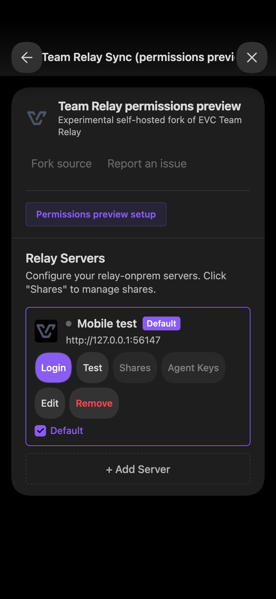
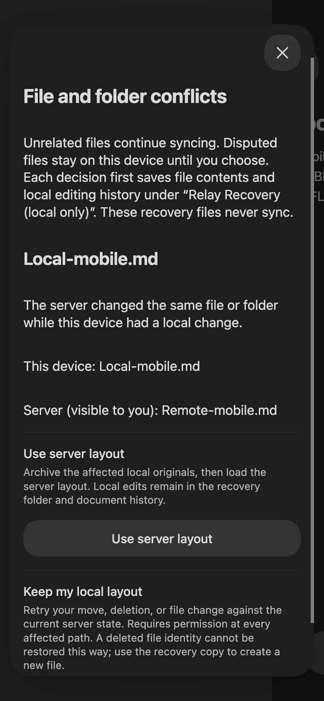

# Desktop Obsidian — portrait

Environment: Obsidian 1.13.7, macOS Chromium, disposable vault
`/private/tmp/evc-mobile-desktop-20261103`, plugin preview 0.2.2.
DevTools Console enabled `this.app.emulateMobile(true)`; responsive viewport
390×844. Dark host appearance. Real loopback control plane and Rust relay.

Passed through actual Obsidian UI:

- Loaded built plugin; local fixture sign-in and retained login after reload.
- Settings navigation, source/issue links without overlap, share navigation,
  permissions entry point, corrected connection row and recovery entry point.
- Typed `Mobile/Portrait.md`; draft survived rotation to 844×390. After saving
  there and reloading Obsidian, reopening the dialog showed the persisted rule.
- Received a note from an independent Yjs peer; typed `MOBILE EDIT TO KEEP`;
  Undo removed it and Redo restored it. A fresh peer received the exact text.
- Used **Relay: disconnect**, entered `OFFLINE MOBILE EDIT TO RECOVER`, renamed
  locally, then reconnected after the server moved the same identity elsewhere.
  The notice opened the actual production conflict dialog.
- Ordinary app reload retained both the offline text and unresolved conflict.
  The decision was completed in landscape; files were then inspected on disk.
- Native host scrolling exposed actions without triggering edits/renames.

Failures fixed: settings-link overlap, cramped connection row, and repeated
Yjs client-ID rotation. Long-path/draft fixes were also loaded. Remaining
console evidence: earlier pre-login timeout warnings and the inherited
`unload` deprecation; no post-reload runtime errors or repeated client-ID warning.

Evidence:

Desktop Chromium emulation does not verify iOS WebKit or a real phone keyboard.
