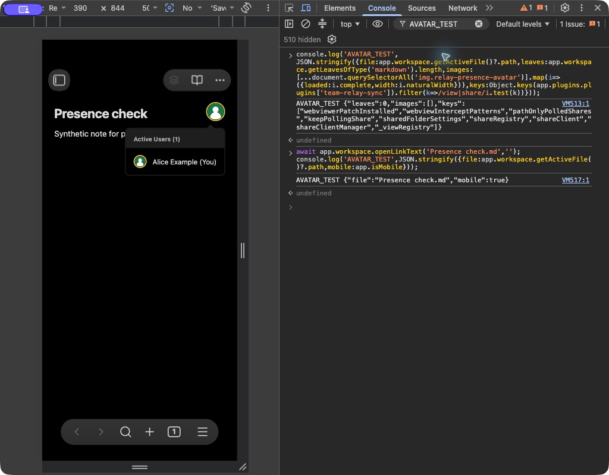
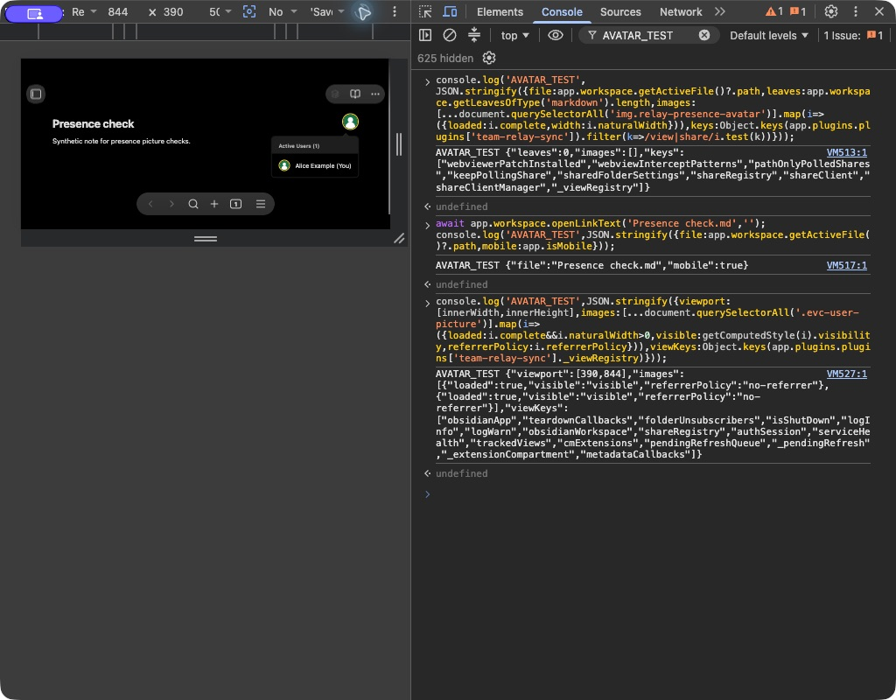
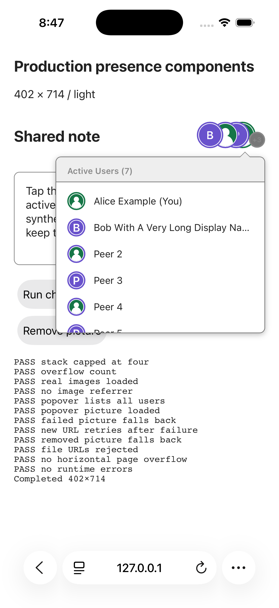
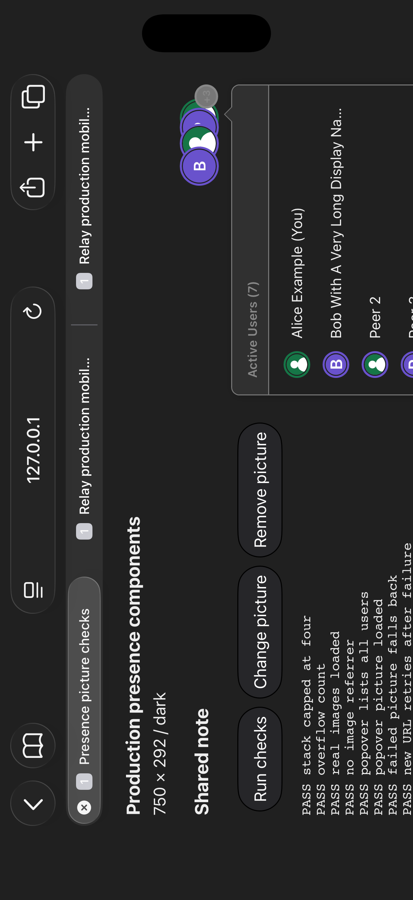

# Presence picture verification — 2026-11-04

Runtime tested: plugin 0.2.4, production source `ae1a17995341bfbd84d715ce059f684bf3c24f99`,
server `7afb42bfa7ea82e18bc38c0133211e1115dd3780`. Later report/harness-only commits
retain the exact runtime bundle. All identities and images in this directory
are synthetic.

| Host | Orientation / viewport | Appearance | Result |
| --- | --- | --- | --- |
| Obsidian 1.13.7, desktop Chromium, mobile emulation | Portrait 390×844 | Dark | Title photo and active-user list rendered, both images decoded, no referrer |
| Obsidian 1.13.7, desktop Chromium, mobile emulation | Landscape 844×390 | Dark | Open list survived rotation; photo and text fit; editing/Undo/Redo/save/reload passed |
| iPhone 17 Pro Simulator, iOS 26.5, Safari | Portrait 402×714 content viewport | Light | 12/12 browser assertions passed, zero captured runtime errors |
| iPhone 17 Pro Simulator, iOS 26.5, Safari | Landscape 750×292 content viewport | Dark | 12/12 browser assertions passed, zero captured runtime errors |

## Actual Obsidian

A separate temporary vault loaded the built plugin and authenticated through
its settings against the isolated FastAPI/Rust stack. The fixture account had
a synthetic OAuth name/picture. After a full host reload, the profile restored
without signing in again. The title icon and popover both loaded the fixture
image with `referrerPolicy: no-referrer`.

At 844×390, actual input appended text, Undo removed it, Redo restored it,
and Save followed by a full reload retained the exact text and loaded picture.
The view registry reported `_isTracking: true` before and after reload.
The existing toolbar tooltip still said “Not tracking” despite that live state;
this pre-existing stale-tooltip issue is outside the picture change.

The initial setup toggled the plugin and produced an existing duplicate-Yjs
warning/error and pre-login sync timeouts. A full reload cleared those setup
messages. The fresh verification/reload run showed no console errors and one
existing live-instance-registry diagnostic warning. DevTools also showed its
existing breaking-change issue indicator. `app.emulateMobile(false)` and device
emulation off restored the host afterwards.

## Simulator Safari

The harness imports actual production presence components and real Yjs awareness,
with only the `activeDocument` host global replaced. Saved JSON records the
assertions, image decode state, viewport, appearance, user agent and errors.
The installed runtime is iOS 26.5; Safari's user agent reports CPU iPhone OS 18_7.

Actual Simulator taps opened the active-user list and used the picture replacement
and removal fixture controls. Rotation with the list open retained its state.
Photos were circular/cropped, and the long identity was truncated within the list.
A tool drag did not scroll the list, consistent with the previously observed
lack of touch-move events from the automation tool. This does **not** verify
real swipe scrolling or prove a product scrolling failure.

Two test-harness issues were corrected and rerun: WebKit reports the SVG image's
natural width at its rendered size, so decoding checks now require a positive
width rather than exactly 64; result POSTs are serialized to prevent simultaneous
writes corrupting the capture. Landscape fixture controls were made compact.
No production source changes were needed after these manual checks.

## Remaining device coverage

Desktop mobile emulation checks the actual Obsidian host in Chromium. Simulator
Safari checks real iOS WebKit with a substitute host. Neither proves native
Obsidian on an iPhone. Physical-device plugin loading, vault access, native UI,
background/resume, keyboard behavior, touch scrolling and performance remain
unverified. This feature adds no form, date/time control, drag interaction or
persisted draft of its own; profile-image changes do not have an Undo operation.
