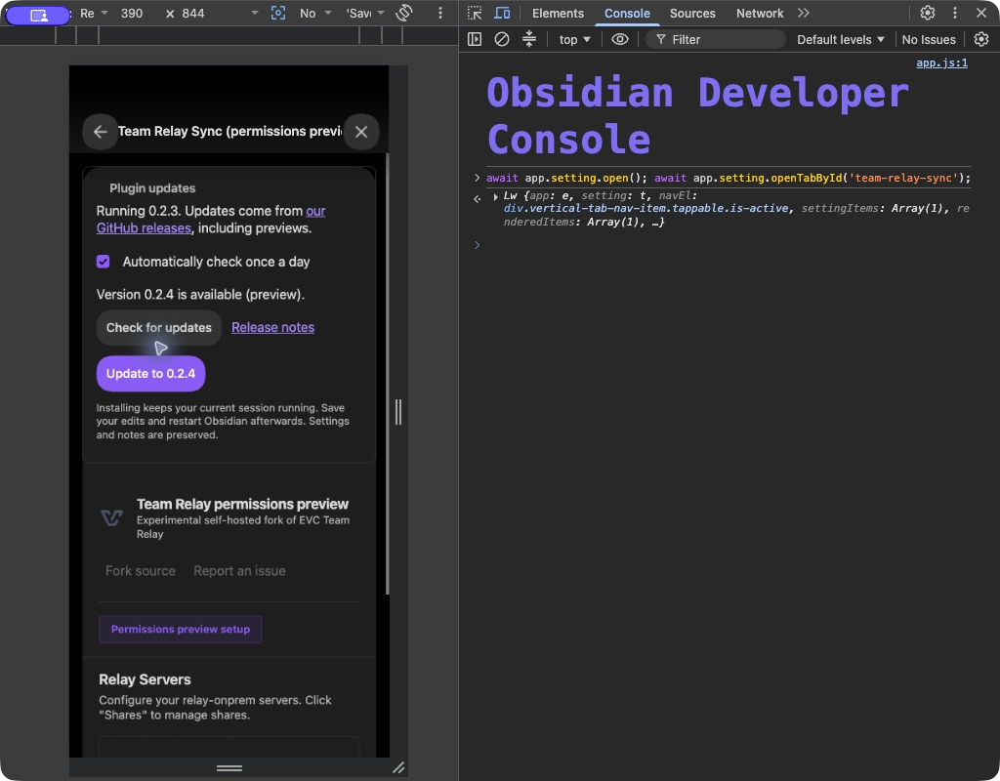
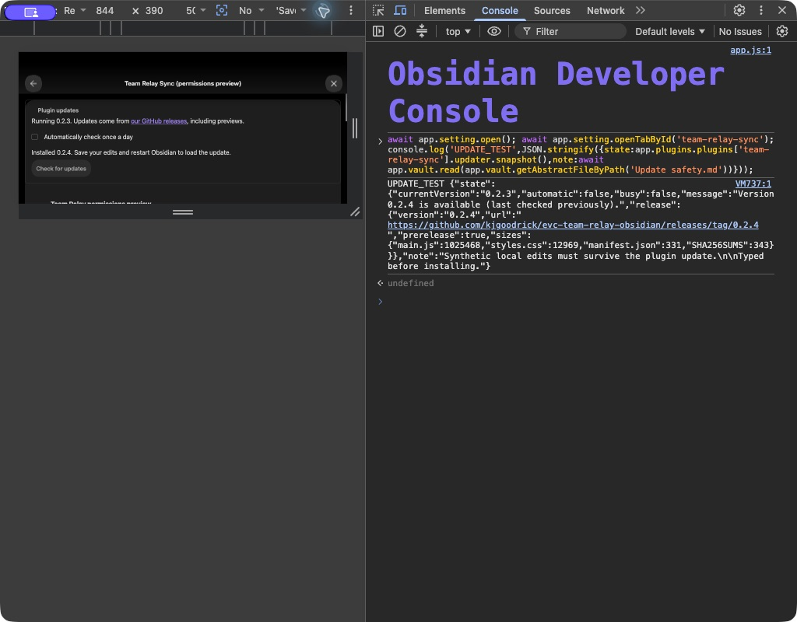
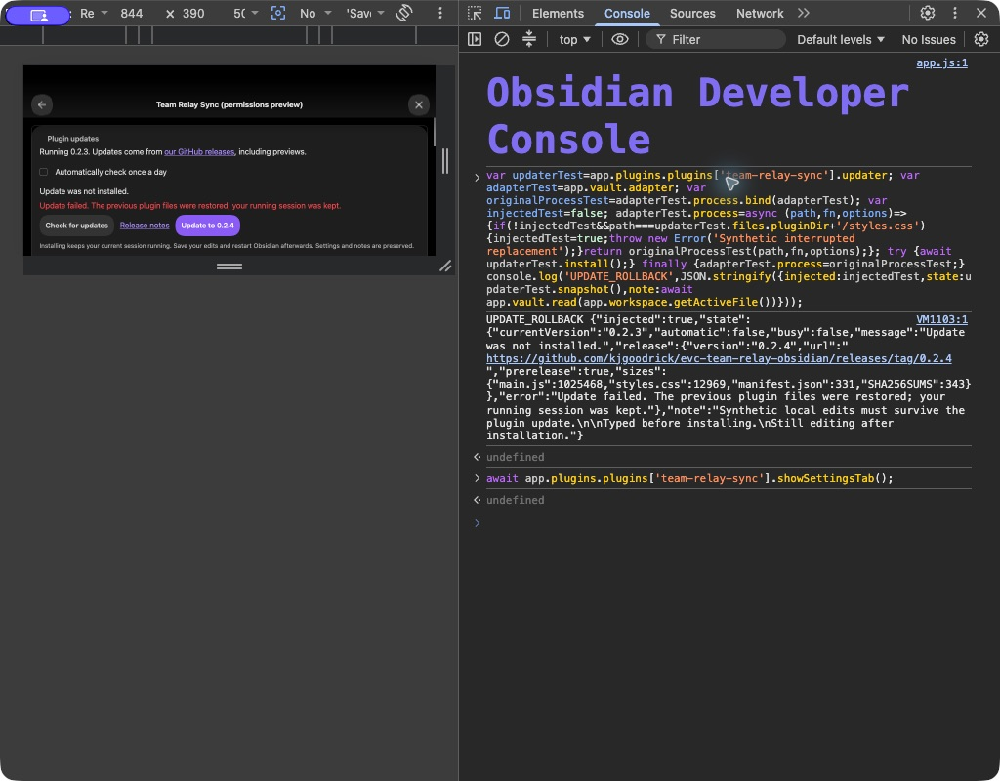
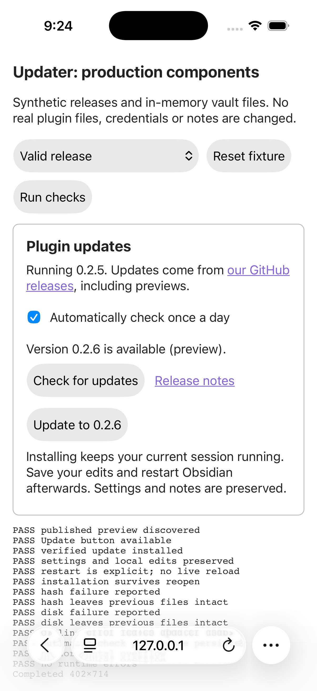
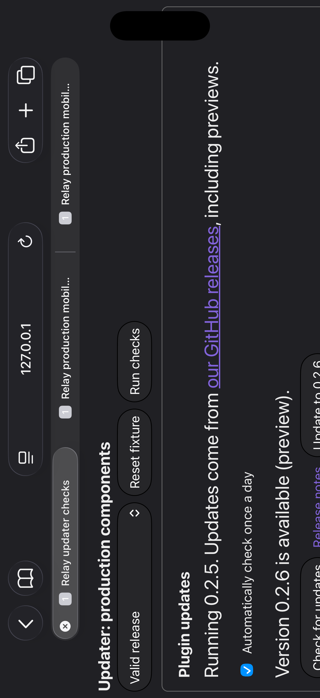

# Updater verification — 2026-11-04

| Host | Orientation / viewport | Appearance | Result |
| --- | --- | --- | --- |
| Obsidian 1.13.7 desktop Chromium, mobile emulation | Portrait 390×844 | Dark | Real GitHub check/download/install; controls fit; preference/cache survives reload |
| Obsidian 1.13.7 desktop Chromium, mobile emulation | Landscape 844×390 | Dark | Installed/restart message survives rotation; note editing/Undo/Redo/save/reload; injected write failure restores original runtime bytes |
| iPhone 17 Pro Simulator, iOS 26.5, Safari | Portrait 402×714 content viewport | Light | 14/14 assertions; real taps on Check and Update; no captured runtime errors |
| iPhone 17 Pro Simulator, iOS 26.5, Safari | Landscape 874×292 content viewport | Dark | 14/14 assertions; preserved state on rotation; no captured runtime errors |

The actual-host fixture uses the production 0.2.5 code with only its local
manifest labelled 0.2.3 so it can install published 0.2.4. All three installed
runtime files matched public 0.2.4 bytes. The existing settings and synthetic
note were preserved. The loaded version remained 0.2.3 until restart, and
editing continued after installation. Undo/Redo and Save worked; after a full
reload the plugin reported 0.2.4 and the exact edited text remained.

For rollback, the final candidate was installed back into the disposable vault.
One process call replacing styles.css was made to throw after main.js had been
updated. The production updater restored all three previous files, reported the
failure, and kept settings/note text. Runtime files and data.json matched the
pre-test SHA-256 values; the journal recorded `restored`. The host adapter's
original process method was reinstated in a finally block. No real vault or
credentials were involved.

The first host test caught an incorrect rename-overwrite assumption. Its safe
failure left runtime files untouched. The implementation and fixture were
corrected to use the public DataAdapter.process API, including verification
and tests for partial writes. The final test run had no console errors. A
complete power-loss transaction across three files is not guaranteed: unreadable
plugin code or a damaged journal still needs manual restoration from backups.

The Safari harness imports the actual production updater, release validation,
file installer and Svelte UI. Its HTTP transport and vault files are synthetic;
real SHA-256 work runs in WebKit. JSON results record viewport, appearance,
assertions, errors and user agent. The installed runtime is iOS 26.5 even though
Safari's user-agent CPU OS reports 18_7.

Actual Simulator taps worked. Tool drags/scroll calls did not move the page,
so touch scrolling is unverified, including reaching the lower actions in
landscape by swiping. The page's assertions are not evidence for native vault
writes, GitHub networking, plugin loading, background/resume or physical-device
performance. No text fields or date/time controls are part of this feature.
Obsidian mobile emulation and device emulation were disabled after testing;
Simulator returned to portrait/light.
